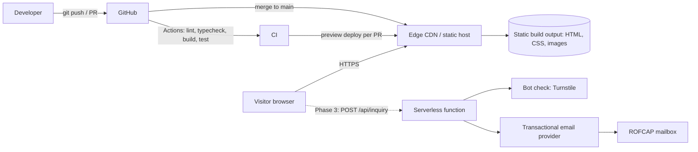
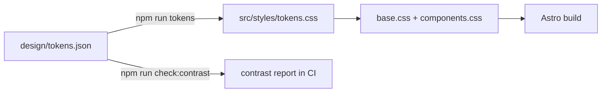
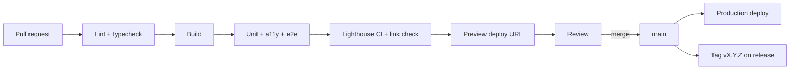

# Architecture — ROFCAP Website

Status: Draft v0.1 — 23 Oct 2026. Decisions are recorded as ADRs in [docs/adr/](adr/) and are **proposed** until the repo owner accepts them.

## 1. Context

The site is a brochure site with a small, growing publishing surface. It has no user accounts, no database and no private data until the optional inquiry form (Phase 3). That shapes the architecture: **static first, with one small serverless function only where a server is genuinely needed.**



## 2. Technology choices

| Layer | Choice | Why | Alternatives considered |
| --- | --- | --- | --- |
| Framework | Astro, static output | Ships zero JS by default, first-class Markdown/MDX content collections for OBSIDIAN, component model maps cleanly to the design-system components | Next.js (heavier than needed), Eleventy (fine, fewer built-in image/content tools), plain HTML (no content pipeline) |
| Language | TypeScript (strict) | Typed content schemas and props | JavaScript |
| Styling | Plain CSS with custom properties generated from `design/tokens.json`; component styles seeded from the design system's `bundle.css` classes | The design system is class-based CSS; avoids a utility framework fighting its rules | Tailwind (conflicts with named-class design system), CSS-in-JS |
| Fonts | Raleway (400/500/600/700/800 + italic 600/700) and IBM Plex Mono (500/600), self-hosted WOFF2 | No third-party request, better privacy and speed | Google Fonts as the design system specifies (see ADR-0003) |
| Images | Astro image pipeline to AVIF/WebP with responsive sizes | Hero is the heaviest asset | Manual export |
| Hosting | Cloudflare Pages (recommended), Netlify or Vercel acceptable | Global CDN, PR previews, instant rollback, serverless functions in the same platform | Self-managed VM/nginx (needless ops) |
| Backend (Phase 3) | One serverless function for `/api/inquiry` | Smallest viable server surface | Third-party form SaaS (adds a processor and branding) |
| Email (Phase 3) | Transactional provider (e.g. Resend, Postmark) | Deliverability, API simplicity | SMTP from the function |
| Bot protection (Phase 3) | Cloudflare Turnstile | Privacy-friendlier than reCAPTCHA | hCaptcha, honeypot only |
| CI/CD | GitHub Actions | Repo already on GitHub | — |
| Testing | Vitest (unit), Playwright (e2e + visual), axe-core (a11y), Lighthouse CI (perf/SEO), lychee (links) | Covers the [test plan](TEST_PLAN.md) | — |

Versions are pinned at scaffold time to the current stable releases and kept in `package.json` / lockfile; this document does not hard-code them.

## 3. Repository layout

See the tree in [README.md](../README.md#target-repository-layout). Principles:

- `design/tokens.json` is the single source of truth for colour, type, spacing, radius, shadow and rule values. It is a copy of the design system's `project/tokens.json`.
- `src/styles/tokens.css` is **generated** from it by `npm run tokens` and never edited by hand.
- `public/` holds assets exactly as named in the design-system asset groups (`Logos`, `Photography`, `Icons`).
- `src/content/` holds Markdown with schema-validated front matter (Phase 2).

## 4. Rendering model

- Build-time rendering (SSG). Output is plain HTML/CSS; JavaScript is limited to progressive enhancements (none in Phase 1).
- One layout (`BaseLayout`) provides `<head>` metadata, skip link, header, `<main>` and footer.
- Pages: `/` (Phase 1), `/404`, `/obsidian`, `/obsidian/[slug]` (Phase 2), `/privacy` (Phase 3 or earlier if counsel requires).

## 5. Component architecture

Each documented design-system component becomes an Astro component with the same class names so the CSS maps one-to-one. Phase 1 uses only the first group.

| Phase | Astro component | Design-system source | Notes |
| --- | --- | --- | --- |
| 1 | `Masthead` | Masthead (light/dark) | Lockup fixed: 48 px mark, "ROFCAP" at 3 px tracking, full name beneath. No navigation inside it |
| 1 | `Hero` | Photography rules + `ObsidianHeader` band language | Translucent photograph over `obsidian`, white title, lava byline, mark on a solid field |
| 1 | `SectionHeader` | SectionHeader | Number tick is the section's only lava |
| 1 | `Card` | Card | One `.accent` (lava) per view at most |
| 1 | `Footer` | Footer | Mark 38 px at 92% opacity, legal text, notice |
| 1 | `StickyNav` | StickyNav | Only if the page gains six or more sections |
| 2 | `ObsidianHeader` | ObsidianHeader | Kicker, title, standfirst; frames rotate across approved photographs |
| 2 | `Callout` (`.q`) | Callout | Once per article |
| 2 | `Pills`, `Table`, `Timeline` | same | Available for article bodies |
| Later | `KpiTiles`, `Layer`, `Fork`, `ScenarioCards`, `SensitivityBars`, `Legend`, `NumberedList`, `Changelog` | same | Document/dashboard components; not planned for the public site |

Rule: if a page needs a pattern that is not in the design system, raise a design-system change first, then implement.

## 6. Content model

```ts
// src/content/config.ts (Phase 2)
obsidian: {
  title: string,
  kicker: string,
  standfirst: string,
  date: Date,
  image: 'eruption-night' | 'lava-flow-cliff' | 'lava-crust'
       | 'lava-river-aerial' | 'lava-glass-red' | 'lava-channel',
  draft: boolean,
}
```

Phase 1 copy lives in `src/content/site.ts` (typed object) so legal edits are a one-file diff.

## 7. Design token pipeline



`check:contrast` asserts the pairs the design system documents (e.g. `ink` on `bg` 9.17:1) so a token change that breaks AA fails CI.

## 8. Phase 3 backend: inquiry endpoint

`POST /api/inquiry` (serverless function)

1. Parse JSON body; reject non-JSON and bodies over 10 KB.
2. Validate with a shared schema (name, email, organisation, message, consent = true).
3. Verify the Turnstile token server-side.
4. Rate limit per IP (platform primitive).
5. Send the email via the provider API; return `202` with a generic body.
6. Log delivery status and a request id only; never log message bodies.

Secrets (`EMAIL_API_KEY`, `TURNSTILE_SECRET`, `INQUIRY_TO`, `INQUIRY_FROM`) live in the host's secret store; `.env.example` lists names only.

## 9. Security

| Control | Detail |
| --- | --- |
| Transport | HTTPS only; HSTS with preload once stable |
| Headers | `Content-Security-Policy` (default-src 'self'; img-src 'self' data:; frame-ancestors 'none'), `X-Content-Type-Options: nosniff`, `Referrer-Policy: strict-origin-when-cross-origin`, `Permissions-Policy` denying unused features |
| Third parties | None in Phase 1; Turnstile and email provider added in Phase 3 and listed in the privacy notice |
| Dependencies | Dependabot (npm + Actions), `npm audit` in CI, lockfile committed |
| Secrets | Never in Git; secret scanning enabled on the repository |
| Branch protection | `main` requires PR, passing checks and one review |
| Links | External links use `rel="noopener noreferrer"` |

## 10. Performance and SEO budget

- Hero: one responsive AVIF/WebP image, `fetchpriority="high"`, explicit dimensions; text rendered over it with a solid dark fallback colour.
- Fonts: preload the two critical WOFF2 files, `font-display: swap`, subset to Latin.
- Critical CSS inlined by the build; no render-blocking third-party requests.
- SEO: canonical `https://www.rofcap.com/`, meta description (currently unset on the live site), Open Graph/Twitter card images at 1200×630 derived from the approved assets, JSON-LD `Organization` with legal name, address and LinkedIn `sameAs`.

## 11. CI/CD



Details and rollback in [DEPLOYMENT.md](DEPLOYMENT.md). The starter workflow is at `.github/workflows/ci.yml`.

## 12. Observability

Phase 1: host uptime monitor and deploy notifications only. Phase 3: function error rate and email-delivery failures to a shared mailbox. Analytics are a Phase 4 decision (open question Q9).

## 13. Decision log

| ADR | Title | Status |
| --- | --- | --- |
| [0001](adr/0001-static-site-with-astro.md) | Static site with Astro | Proposed |
| [0002](adr/0002-tokens-as-source-of-truth.md) | Design tokens as the single source of truth | Proposed |
| [0003](adr/0003-self-host-fonts.md) | Self-host fonts instead of Google Fonts | Proposed |
| [0004](adr/0004-serverless-inquiry-endpoint.md) | Serverless endpoint for the inquiry form | Proposed |
